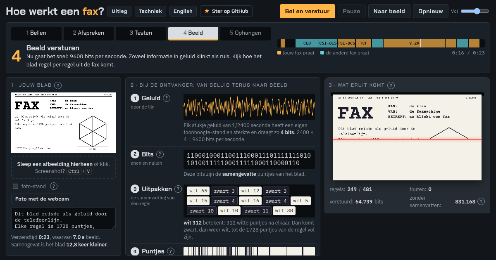

# Faxlijn 9600: hoe werkt een fax? · how does a fax work?

**[▶ Open de simulatie / open the simulation](https://johancoppens.github.io/fax/)** · [Nederlands](#nederlands) · [English](#english)

[](https://johancoppens.github.io/fax/)

---

## Nederlands

Een interactieve simulatie van een Group 3-fax (de soort die vanaf 1980 overal stond), voor de klas. Je hoort het echte geluid van een fax en ziet live hoe de ontvanger de piepjes terug omzet: geluid → enen en nullen → betekenis → puntjes op papier.

De fax werd uitgevonden in 1843 door Alexander Bain, 33 jaar vóór de telefoon, en was al in 1865 in gebruik tussen Parijs en Lyon.

### Gebruik

Open [johancoppens.github.io/fax](https://johancoppens.github.io/fax/), of open `index.html` in een browser. Eén bestand, geen installatie, geen account, geen server. Alleen de lettertypes komen van Google Fonts; zonder internet worden standaardlettertypes gebruikt.

- **Bel en verstuur** speelt het hele gesprek af (ongeveer 25 s): bellen, afspreken, testen, beeld, ophangen.
- Eigen inhoud: typ een bericht, sleep een afbeelding in het venster, plak een screenshot (Ctrl+V) of neem een foto met de webcam.
- Uitleg zit achter de **?**-knopjes en in **Uitleg**; **Techniek** toont spectrogram, constellatie en protocol.
- De taal volgt de browser. Met de knop wissel je, of dwing ze af in de link: `?lang=nl` of `?lang=en`.

De webcam werkt op de website (https) en wanneer je het bestand rechtstreeks opent. In een afgeschermd kader valt de knop terug op de camera-invoer van de browser (gsm, tablet) of een bestandskiezer.

### Wat leerlingen leren

- analoog en digitaal; waar A/D- en D/A-omzetting gebeuren (scanner, modem, printer)
- bits en bitsnelheid (300 en 9600 bits per seconde)
- compressie: run-lengtes en korte codes voor wat vaak voorkomt
- geluid als drager van informatie: frequentie, fase, ruis
- protocollen en foutcontrole

Voor secundair onderwijs (informatica, STEM, fysica, elektronica), 15 tot 50 minuten.

---

## English

An interactive simulation of a Group 3 fax machine (the kind found in every office from 1980 on), for the classroom. You hear the real sound of a fax call and watch the receiver turn the beeps back into a picture: sound → ones and zeros → meaning → dots on paper.

The fax was invented in 1843 by Alexander Bain, 33 years before the telephone, and was already in use between Paris and Lyon in 1865.

### Use

Open [johancoppens.github.io/fax](https://johancoppens.github.io/fax/), or open `index.html` in a browser. One file, no install, no account, no server. Only the fonts come from Google Fonts; offline, system fonts are used.

- **Call and send** plays the whole call (about 25 s): call, agree, test, page, hang up.
- Your own content: type a message, drop an image on the page, paste a screenshot (Ctrl+V) or take a webcam photo.
- Explanations sit behind the **?** buttons and in **About**; **Technical** shows the spectrogram, constellation and protocol.
- The language follows the browser. Switch with the button, or force it in the link: `?lang=en` or `?lang=nl`.

The webcam works on the website (https) and when the file is opened directly. In a sandboxed frame the button falls back to the browser's camera input (phone, tablet) or a file picker.

### What students learn

- analog and digital; where A/D and D/A conversion happen (scanner, modem, printer)
- bits and bit rate (300 and 9600 bits per second)
- compression: run lengths and short codes for what is common
- sound as a carrier of information: frequency, phase, noise
- protocols and error checking

For secondary school (computer science, STEM, physics, electronics), 15 to 50 minutes.

---

## How it works · technisch

The sound is computed from the ITU standards and the receiver decodes it again from the audio:

- **T.30** handshake: CNG 1100 Hz, CED 2100 Hz, HDLC frames (CSI, DIS, TSI, DCS, CFR, EOP, MCF, DCN) with CRC
- **V.21** FSK at 300 bit/s (1650 Hz = 1, 1850 Hz = 0)
- **V.29** QAM at 9600 bit/s: 2400 baud, 1700 Hz carrier, 16 points, scrambler 1 + x⁻¹⁸ + x⁻²³, training sequence
- **T.4** Modified Huffman: run lengths, EOL, RTC; 1728 dots per line, 3.85 lines per mm

Simplified: the receiver already knows the symbol clock and carrier phase (the training only sets the gain), the pause after CNG is shorter, there is no NSF frame, and the bits in DIS and DCS do not follow the standard exactly. Sound is generated at 24 kHz with some line noise.

### Layout of `index.html`

- `<head>`: metadata for search engines and link previews (Open Graph, JSON-LD with a FAQ), and a small script that picks the language before the first paint.
- `<style>`: layout, colours as tokens at the top. Every text exists in both languages (`lang="nl"` / `lang="en"`); the `lang` of `<html>` shows one.
- `<script id="core">`: the core without DOM: code tables, HDLC, V.21, V.29, synthesis (`buildCall`) and the decoder (`Monitor`).
- the last `<script>`: the page: drawing, audio, upload, webcam, tooltips, language.

`?snapshot=0.6` freezes the view 60 % into the page without sound; `og.png` (the link preview) is made with it:

```sh
google-chrome --headless=new --window-size=1200,630 --virtual-time-budget=8000 \
  --screenshot=og.png "file://$PWD/index.html?lang=nl&snapshot=0.6"
```

### Test

```sh
node test/roundtrip.js
```

Synthesises a whole call with a test sheet, decodes it from the audio and checks that every frame has a correct CRC, the TCF test has no errors and all 481 lines come back bit-exact. The test reads the core straight from `index.html`.

### Search and AI

`sitemap.xml` lists the page, `llms.txt` describes it for AI assistants, and the JSON-LD in `index.html` marks it as a free learning resource with a FAQ in both languages.

---

## Licentie · Licence

© 2026 Johan Coppens. [CC BY 4.0](https://creativecommons.org/licenses/by/4.0/): je mag het delen en aanpassen, ook commercieel, als je de maker vermeldt. You may share and adapt it, also commercially, as long as you credit the author. Full text: [LICENSE](LICENSE).
